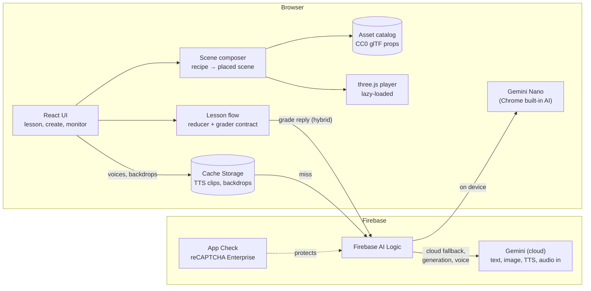

# SceneSpeak

**Learn the conversation you actually need.**

SceneSpeak is a cozy, low-poly language practice app. Pick a short lesson, or type the situation you're worried about ("opening a bank account", "asking a neighbour to borrow a ladder"), and SceneSpeak builds a small 3D scene with a chibi character to practise it with. Every reply you type is graded by **Gemini Nano on your own device**, so practice is private, instant and free. Cloud Gemini does the heavy creative work: writing new lessons, painting backdrops and voicing characters.

Spanish only for now. Built for the Firebase **#BuildHybridAI** hackathon.

> **Status:** early. The 3D scenes, lesson flow and UI work today. The AI pieces plug in through small typed interfaces and are being wired up; features marked *in progress* below don't work yet.

## Features

| Feature | Status |
| --- | --- |
| Featured lessons in 3D scenes: *Meet the neighbour* (workshop), *Ordering at the bakery*, *Coffee at the café* | ✅ Works |
| Accounts: start as an anonymous guest, upgrade to Google without losing your user ID | ✅ Works |
| Scene composer: a JSON scene recipe (catalog IDs + slots) → laid-out 3D set with no overlaps and auto-framed camera, with a fallback room | ✅ Works |
| Asset catalog of 25 CC0 props, 3 rooms, 4 characters (toy-like chibis built in code) | ✅ Works |
| Reply grading on device with Gemini Nano (cloud fallback), with an "on device / cloud" badge | 🚧 In progress |
| "Create a lesson" from a typed request | 🚧 In progress (UI done, generator not connected) |
| AI-painted 2D backdrop behind the 3D set | 🚧 In progress (UI with gradient fallback done) |
| Character voices (cloud TTS, generated once and cached) with captions | 🚧 In progress (player and cache done) |
| Push-to-talk voice replies, graded in the cloud and never stored | 🚧 In progress (recorder UI done) |
| Model Monitor: where each AI call ran, latency, cloud calls saved | ✅ UI works; fills in once AI calls are connected |

## How hybrid inference is used

All AI goes through [Firebase AI Logic](https://firebase.google.com/docs/ai-logic) (`firebase/ai`) with hybrid inference: on-device first, cloud when it's needed.

| Job | Runs on | Why |
| --- | --- | --- |
| Grade typed replies → structured `Grade` JSON | **Device** (cloud fallback) | Happens on every reply, so it should be private, instant and free |
| Live hints while typing | **Device only** | Only practical because device calls cost nothing |
| On-script vs off-script check | **Device** | Decides whether the cloud is needed at all |
| Safety check and removing personal details from a lesson request | **Device** | Nothing personal reaches the cloud |
| Write a new lesson (`Scenario` + scene recipe from the asset catalog) | **Cloud** | Long, creative structured output |
| Paint the backdrop | **Cloud** | Image generation |
| Character voices (TTS) | **Cloud**, once per line, then cached | The device model can't output audio |
| Voice replies: transcribe and grade | **Cloud**, opt-in, never stored | The device model doesn't take audio input |

Cloud-generated media (voice clips, backdrops) is cached by content hash, so each is generated once. The Model Monitor counts every successful on-device call as a cloud call saved.

## Architecture



The lesson generator never invents geometry: it picks room, character and props from the catalog by ID and drops them into named slots (`counter`, `counter-top`, `back`, `floor-left`, `floor-right`). The recipe is validated with Zod, unknown IDs are dropped or replaced with fallbacks, and the composer lays everything out.

## Setup

Requires Node 25 and pnpm 12 (`npx -y pnpm@12.15.0 <command>` works if pnpm isn't installed).

### 1. Firebase project

1. Create a project in the [Firebase console](https://console.firebase.google.com/).
2. Open **AI Logic** and enable it with the **Gemini Developer API** provider.
3. In **Project settings → Your apps**, register a **Web app** and copy its config.

### 2. App Check (required by AI Logic)

1. In **App Check**, register the web app with **reCAPTCHA Enterprise** and copy the site key.
2. For local development, add a **debug token** under App Check → Apps → ⋮ → Manage debug tokens. If you leave the token empty in `.env.local`, the dev build prints a new one in the browser console for you to register.

### 3. Authentication

In **Authentication → Sign-in method**, enable **Anonymous** and **Google**. Everyone starts as a guest; "Sign in with Google" links the guest to a Google account. If Anonymous is off, the app just offers Google sign-in.

### 4. Environment

```bash
cp .env.example .env.local
```

Fill in the `VITE_FIREBASE_*` values, the App Check site key and (for development) the debug token. `.env.local` is git-ignored.

### 5. Run

```bash
pnpm install
pnpm dev
```

Open http://localhost:5173.

### 6. On-device model (Gemini Nano)

- Desktop Chrome 139 or later.
- Enable `chrome://flags/#prompt-api-for-gemini-nano-multimodal-input`, then restart Chrome.
- The model downloads on first use; Chrome only allows that after a click.
- Other browsers fall back to the cloud.

### Deploying (optional)

Copy `.firebaserc.example` to `.firebaserc` (git-ignored) with your project ID, then use the Firebase CLI to deploy `dist/` to Hosting.

## Scripts

| Script | What it does |
| --- | --- |
| `pnpm dev` | Start the Vite dev server |
| `pnpm build` | Typecheck, then build to `dist/` |
| `pnpm typecheck` | `tsc --noEmit` |
| `pnpm test` | Run the Vitest suite once |

## Project structure

```
src/
  ai/          Firebase setup: env validation, App Check, AI Logic client
  auth/        Firebase Auth client (anonymous guest → Google), account view model
  audio/       Media interfaces (TTS, backdrop painter, voice), push-to-talk recorder
  cache/       Generate-once cache for cloud media (memory or Cache Storage)
  lesson/      Lesson reducer, grader + generator contracts, featured lessons
  monitor/     Model Monitor events and summary
  routing/     On-device vs cloud routing policy
  scene/
    catalog/   Props, rooms, characters the generator may use
    recipe/    Scene recipe schema (Zod) + catalog resolution
    composer/  Slot layout and camera framing (pure, tested)
    *.ts(x)    three.js player, chibi characters, rooms, backdrop layer
  schemas/     Zod schemas for model output: Grade, Scenario, …
  services/    Wires real or stub AI services into the UI
  ui/          React screens and components
public/assets/ CC0 glTF models used by the catalog
```

Tests sit next to the code (`foo.ts` + `foo.test.ts`) and never call real AI; fakes are injected.

## Privacy

- Typed replies are graded on your device when Gemini Nano is available.
- Voice replies are opt-in, labelled as cloud, sent to the model call only, and never stored or logged.
- No analytics or tracking. Accounts are optional: guests are anonymous, and Google sign-in only stores your uid and display name in Firebase Auth.

## Credits

- 3D props: [KayKit Restaurant Bits](https://kaylousberg.itch.io/restaurant-bits) by [Kay Lousberg](https://kaylousberg.com) (CC0). License file in `public/assets/kaykit-restaurant/`.
- Fonts: [Fredoka](https://fonts.google.com/specimen/Fredoka) and [Nunito](https://fonts.google.com/specimen/Nunito) (SIL Open Font License), via Google Fonts.
- Built with [Firebase](https://firebase.google.com), [three.js](https://threejs.org), [React](https://react.dev), [Vite](https://vite.dev) and [Zod](https://zod.dev).

## License

[Apache-2.0](LICENSE)
