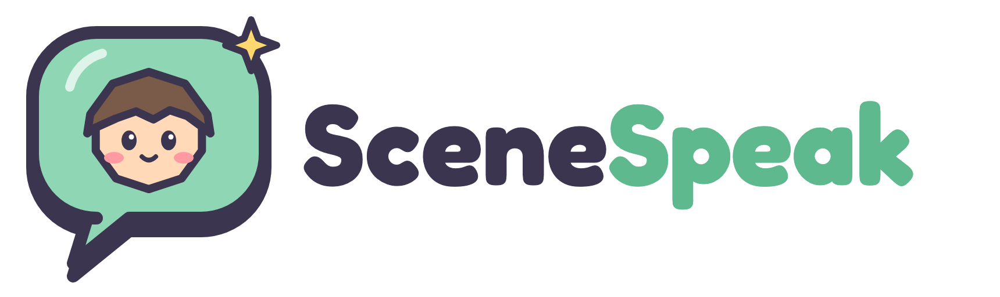
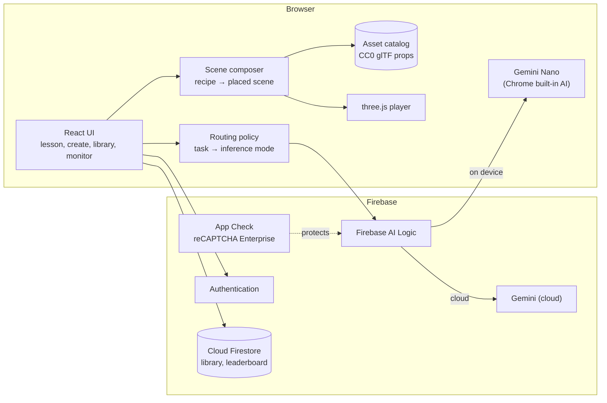

<div align="center">



**Learn the conversation you actually need.**

Type the situation you're nervous about and practise it in a cozy 3D scene.<br>
Gemini Nano grades every reply **privately on your device**; cloud Gemini does the creative heavy lifting.

[](https://github.com/Xlient/SceneSpeak/actions/workflows/ci.yml)
[](LICENSE)
[](#scripts)
[](tsconfig.json)
[](https://firebase.google.com/docs/ai-logic)
[](https://firebasehybridaihackathon.devpost.com/)

[**For judges**](#for-judges) ·
[**Quick start**](#quick-start) ·
[**How hybrid works**](#how-hybrid-inference-is-used) ·
[**Contributing**](#contributing) ·
[**Add a lesson**](packages/core/lessons/README.md)

Live demo: *coming soon* · Demo video: *coming soon*

</div>

---

## Contents

- [For judges](#for-judges)
- [Why SceneSpeak](#why-scenespeak)
- [Features](#features)
- [How hybrid inference is used](#how-hybrid-inference-is-used)
- [Architecture](#architecture)
- [Quick start](#quick-start)
- [Full setup](#full-setup)
- [Scripts](#scripts)
- [Project structure](#project-structure)
- [Contributing](#contributing)
- [Privacy](#privacy)
- [Credits](#credits)
- [License](#license)

## For judges

**Try it in about two minutes**

1. Open the live demo in desktop **Chrome 139+** (or [run it locally](#quick-start)).
2. Optional, for on-device AI: enable `chrome://flags/#prompt-api-for-gemini-nano-multimodal-input` and restart Chrome. The welcome tour downloads Gemini Nano after one click. Without it everything still works and grades in the cloud.
3. Play **Coffee at the café**, then tap **Create** and type a situation of your own.
4. Open the **Model Monitor** to see where every AI call ran, why, and how many cloud calls were saved.

No account needed: you start as an anonymous guest.

**Where Firebase AI Logic runs in the code**

| What | File |
| --- | --- |
| Firebase app + App Check (reCAPTCHA Enterprise) | [`packages/core/src/ai/firebase.ts`](packages/core/src/ai/firebase.ts) |
| Hybrid model factory (`InferenceMode`, `getGenerativeModel`) | [`packages/core/src/ai/model.ts`](packages/core/src/ai/model.ts) |
| On-device model setup and download | [`packages/core/src/ai/device.ts`](packages/core/src/ai/device.ts) |
| Routing policy: picks the inference mode per call | [`packages/core/src/routing/route.ts`](packages/core/src/routing/route.ts) |
| Every AI capability wired into the app | [`packages/core/src/services/app-services.ts`](packages/core/src/services/app-services.ts) |

**Hackathon requirements at a glance**

| Requirement | Where |
| --- | --- |
| Firebase AI Logic, imported and called at runtime | Files above |
| Hybrid inference with Gemini Nano on Web (Chrome) | [How hybrid inference is used](#how-hybrid-inference-is-used) |
| App Check | [`packages/core/src/ai/firebase.ts`](packages/core/src/ai/firebase.ts) |
| Other Firebase products | Authentication, Cloud Firestore and Cloud Storage (with emulator-tested rules), Hosting |
| Open source license | [AGPL-3.0](LICENSE) |
| Free to use, English UI | Yes |

## Why SceneSpeak

Phrasebooks teach you "the pen is on the table". What you actually need is the one conversation you're worried about: opening a bank account, checking into a hotel, asking a neighbour for a ladder. Practising that out loud with a person is awkward, tutors cost money, and most apps make you wade through a fixed curriculum to get there.

SceneSpeak turns that one situation into a five-minute role-play with a cute character in a low-poly 3D scene. Because you make a lot of mistakes while learning, the grading happens on your own device: private, instant and free.

**Who it's for:** adult beginners (A1 to B1) preparing for travel, a move or a new job. Spanish today; more languages are welcome as [community lessons](packages/core/lessons/README.md).

## Features

| | Feature | Runs on |
| --- | --- | --- |
| 🎬 | **Featured lessons in 3D:** *Coffee at the café*, *Ordering at the bakery*, *Meet the neighbour* | — |
| ✍️ | **Create a lesson from a sentence:** a private on-device check, then a cloud-written role-play and a 3D set built from the asset catalog | Device + cloud |
| ✅ | **Instant feedback** on every typed reply: a score, a friendlier way to say it, and a hint | Device first |
| 🧩 | **Grammar breakdown** of any line, compared with English | Device first |
| 🎙️ | **Speaking mode** (opt-in): push to talk, graded in the cloud, never stored | Cloud |
| 📚 | **Lesson library:** share lessons, upvote, report; duplicates are suggested before writing a new one | Device + Firestore |
| ⭐ | **Progress:** stars, points, streaks and phrases to review, kept in your browser | Local |
| 🧑‍🏫 | **Weekly coach** that reads your stats without them leaving the device | Device only |
| 🏆 | **Weekly leaderboard** (opt-in): only a first name and days practised | Firestore |
| 🎨 | **AI-painted backdrops** matched to the room's colours, painted once and shared through a cache | Cloud + Storage |
| 📊 | **Model Monitor:** path, latency and routing reason for every AI call | — |
| 👋 | **Welcome tour** that sets up on-device AI, plus Privacy and Terms pages | — |

**Next:** cloud character voices (the player and cache are built), more languages, and a mobile app.

## How hybrid inference is used

All AI goes through [Firebase AI Logic](https://firebase.google.com/docs/ai-logic) (`firebase/ai`). A small, unit-tested [routing policy](packages/core/src/routing/route.ts) picks the mode for each call from ordered rules: privacy, capability, language support, connectivity, input size and the state of the on-device model. Each decision carries a plain-language reason that shows up in the Model Monitor.

| Job | Runs on | Why |
| --- | --- | --- |
| Grade a typed reply → `Grade` JSON | **Device first**, cloud fallback | Every reply: private, instant, free |
| Grammar breakdown | **Device first** | Short, frequent, personal |
| Check a lesson request (safety, topic, skills) | **Device first** | The request may be personal |
| "Is there already a lesson for this?" | **Device first** | A cheap judgement that can save a cloud call |
| Weekly coach recap | **Device only** | Practice stats never leave the browser |
| Write a new lesson (scenario + scene recipe) | **Cloud** | Long, creative structured output |
| Grade a voice reply (audio in) | **Cloud**, opt-in | The on-device model takes no audio |
| Offline with Nano ready | **Device only** | Practice keeps working without Wi-Fi |

**Model output is untrusted.** Every response is validated with Zod, and a reply grade with invalid JSON is retried once. Generated lessons only use room, character and prop IDs from the asset catalog, get one repair attempt if invalid, and are laid out by a pure, tested scene composer, so the model never invents geometry. Personal details are removed from lesson requests before any model sees them.

## Architecture



## Quick start

Requires **Node 25** and **pnpm 12** (`npx -y pnpm@12.15.0 <command>` works if pnpm isn't installed).

```bash
git clone https://github.com/Xlient/SceneSpeak.git
cd SceneSpeak
pnpm install
cp .env.example .env.local   # fill in your Firebase values (see Full setup)
pnpm dev
```

Open http://localhost:5173.

### Mobile app (Android, iOS, web)

The Expo app in `apps/mobile` shares lessons, scenes, schemas, grading and routing with the web app. It has the 3D lessons in Typing and Speaking mode with character voices, Create a lesson, Community, Leaderboard, the Model Monitor, the welcome tour, and Privacy and Terms. AI calls on phones go through the native Firebase AI Logic bridge in `apps/mobile/modules/hybrid-ai`, which is still being connected; until then only exact example phrases are graded.

```bash
pnpm mobile                                       # Expo dev server; press w for web
pnpm --filter @scenespeak/mobile android          # dev build on an Android device or emulator
pnpm --filter @scenespeak/mobile ios              # dev build in the iOS simulator (needs Xcode)
```

For Firebase on mobile, create `apps/mobile/.env.local` with the same values as the web app, using the `EXPO_PUBLIC_FIREBASE_*` names: `API_KEY`, `AUTH_DOMAIN`, `PROJECT_ID`, `STORAGE_BUCKET`, `MESSAGING_SENDER_ID` and `APP_ID`. Without it the app runs offline. Native on-device AI also needs `google-services.json` (Android) and `GoogleService-Info.plist` (iOS) in `apps/mobile/`. Both are git-ignored.

Google sign-in on mobile (optional) needs two more values in `apps/mobile/.env.local`:

- `EXPO_PUBLIC_GOOGLE_WEB_CLIENT_ID`: the "Web client" OAuth ID that Firebase created (Authentication → Sign-in method → Google → Web SDK configuration).
- `EXPO_PUBLIC_GOOGLE_IOS_URL_SCHEME`: the reversed iOS client ID from `GoogleService-Info.plist` (`REVERSED_CLIENT_ID`). For Android, add your debug and release SHA-1 fingerprints to the Android app in Firebase.

After adding or changing native settings, regenerate the native projects with `pnpm --filter @scenespeak/mobile exec expo prebuild`, then rebuild.

### Releases

| Platform | How | Output |
| --- | --- | --- |
| Web | [`deploy.yml`](.github/workflows/deploy.yml): pull requests get a preview URL, `main` goes live on Firebase Hosting | `apps/web/dist/` |
| Android | [`android-release.yml`](.github/workflows/android-release.yml): push a `v*` tag or run it from Actions | `SceneSpeak-<version>.apk` on the GitHub Release |
| iOS Simulator | [`ios-simulator.yml`](.github/workflows/ios-simulator.yml): same triggers, no Apple Developer account needed | `SceneSpeak-simulator.zip` (unzip, drag the `.app` onto a simulator) |

The Android APK is debug-signed unless the `ANDROID_UPLOAD_*` secrets are set; that's fine for sideloading, but Google Play needs the upload key. Both mobile workflows read the Firebase and Google sign-in values from the repository's Actions variables (listed at the top of each workflow).

## Full setup

<details>
<summary><b>1. Firebase project and AI Logic</b></summary>

1. Create a project in the [Firebase console](https://console.firebase.google.com/).
2. Open **AI Logic** and enable it with the **Gemini Developer API** provider.
3. In **Project settings → Your apps**, register a **Web app** and copy its config.

</details>

<details>
<summary><b>2. App Check (required by AI Logic)</b></summary>

1. In **App Check**, register the web app with **reCAPTCHA Enterprise** and copy the site key.
2. For local development, add a **debug token** under App Check → Apps → ⋮ → Manage debug tokens. If you leave the token empty in `.env.local`, the dev build prints a new one in the browser console for you to register.

</details>

<details>
<summary><b>3. Authentication</b></summary>

In **Authentication → Sign-in method**, enable **Anonymous** and **Google**. Everyone starts as a guest; "Sign in with Google" links the guest to a Google account. If Anonymous is off, the app just offers Google sign-in.

</details>

<details>
<summary><b>4. Firestore (lesson library and leaderboard)</b></summary>

Create a **Firestore** database, then deploy the rules and indexes:

```bash
pnpm exec firebase deploy --only firestore
```

Without Firestore, sharing to the library is off and the Leaderboard shows only your local stats; featured and community lessons still work.

</details>

<details>
<summary><b>5. Environment</b></summary>

```bash
cp .env.example .env.local
```

Fill in the `VITE_FIREBASE_*` values, the App Check site key and (for development) the debug token. `.env.local` is git-ignored; never commit real keys.

</details>

<details>
<summary><b>6. On-device model (Gemini Nano)</b></summary>

- Desktop Chrome 139 or later.
- Enable `chrome://flags/#prompt-api-for-gemini-nano-multimodal-input`, then restart Chrome.
- The model downloads on first use; Chrome only allows that after a click.
- Other browsers fall back to the cloud.

</details>

<details>
<summary><b>7. AI backdrops and shared cache (optional)</b></summary>

Painted backdrops use an image model, which needs the **Gemini API paid tier** (image models have no free tier). Without it, scenes keep their gradient sky.

Backdrops are cached in the browser and, with Cloud Storage set up, shared between all players so each scene is painted once. They use their own bucket, not the default one:

1. In **Storage**, click **Get Started** (creates the default bucket, which the rules keep closed).
2. Create a bucket for backdrops and link it to Firebase (Storage → **Add bucket**, or `gcloud storage buckets create gs://YOUR-PROJECT-backdrops --location us-east1 --uniform-bucket-level-access --public-access-prevention`, then import it in the console).
3. Map the storage targets (`pnpm exec firebase target:apply storage backdrops YOUR-PROJECT-backdrops` and `… storage default YOUR-PROJECT.firebasestorage.app`, see `.firebaserc.example`), set `VITE_FIREBASE_BACKDROP_BUCKET` in `.env.local`, and deploy: `pnpm exec firebase deploy --only storage,firestore`.
4. Allow browser downloads from your domains: `gcloud storage buckets update gs://YOUR-PROJECT-backdrops --cors-file=cors.json`.

</details>

<details>
<summary><b>8. Deploying (optional)</b></summary>

Copy `.firebaserc.example` to `.firebaserc` (git-ignored) with your project ID, then use the Firebase CLI to deploy `apps/web/dist/` to Hosting.

To deploy from GitHub instead, add the secrets and variable listed at the top of [`.github/workflows/deploy.yml`](.github/workflows/deploy.yml). Pull requests then get a preview URL, and pushes to `main` go live.

</details>

## Scripts

| Script | What it does |
| --- | --- |
| `pnpm dev` | Start the web app (Vite) |
| `pnpm mobile` | Start the Expo dev server for the Android, iOS and web app |
| `pnpm build` | Typecheck, then build the web app to `apps/web/dist/` |
| `pnpm typecheck` | `tsc --noEmit` in every package |
| `pnpm test` | Run every package's Vitest suite (also validates every lesson) |
| `pnpm test:rules` | Test `firestore.rules` and `storage.rules` against the emulators (needs Java 21+) |

## Project structure

```
packages/core/       Shared TypeScript used by every app (no UI)
  src/ai/            Firebase AI Logic client, prompts, parsers, App Check
  src/routing/       On-device vs cloud routing policy
  src/services/      Wires the real AI services (or stubs) into the UI
  src/lesson/        Lesson flow, scoring, featured lessons, generator contract
  src/library/       Shared lesson library (Firestore)
  src/leaderboard/   Opt-in weekly board (Firestore)
  src/auth/          Anonymous guest → Google
  src/scene/         Asset catalog, scene recipes, composer, rooms and chibis
  src/audio/         Voice interfaces
  src/monitor/       Model Monitor events and summary
  src/schemas/       Zod schemas for model output
  lessons/           Community lessons, one JSON file per lesson
apps/web/            Web app (Vite + React + three.js), the full feature set
  public/assets/     CC0 glTF models used by the catalog
apps/mobile/         Expo app for Android, iOS and web (React Native + React Three Fiber)
  app/               Screens (Expo Router)
  src/scene/         R3F scene player
  src/ai-port/       Contract for native on-device AI
  modules/hybrid-ai/ Native bridge to Firebase AI Logic (Android, iOS)
rules-tests/         Firestore security-rules tests (emulator)
```

## Contributing

Contributions are welcome, especially **new lessons in any language**.

- **Add a lesson:** follow [`packages/core/lessons/README.md`](packages/core/lessons/README.md). It's one JSON file, `pnpm test` checks it, and a lesson mod reviews the pull request.
- **Code changes:** open an issue first for anything large, then a pull request using the [template](.github/pull_request_template.md).

**Before you open a pull request**

```bash
pnpm typecheck && pnpm test && pnpm build
```

**Conventions**

- TypeScript strict, no `any`. kebab-case file names, named exports.
- Validate external data with Zod at every boundary; treat model output as untrusted.
- Tests sit next to the code (`foo.ts` + `foo.test.ts`) and never call real AI: inject fakes.
- All AI goes through Firebase AI Logic (`firebase/ai`); no other AI SDKs.
- No secrets in the repo, and never store images or voice recordings.
- Keep the UI family-friendly and consistent with the tokens in [`apps/web/src/ui/styles.css`](apps/web/src/ui/styles.css).

By contributing you agree that your contribution is licensed under the [AGPL-3.0](LICENSE).

## Privacy

- Typed replies are graded on your device when Gemini Nano is available.
- Personal details are removed from lesson requests before any model sees them.
- Voice replies are opt-in, labelled as cloud, sent to the model call only, and never stored or logged.
- Progress stays in your browser. The weekly leaderboard is opt-in and stores only a first name and days practised.
- No analytics or tracking. Guests are anonymous; Google sign-in stores only your uid and display name in Firebase Auth.

## Credits

- 3D props: [KayKit Restaurant Bits](https://kaylousberg.itch.io/restaurant-bits) by [Kay Lousberg](https://kaylousberg.com) (CC0). License file in `apps/web/public/assets/kaykit-restaurant/`.
- Fonts: [Fredoka](https://fonts.google.com/specimen/Fredoka) and [Nunito](https://fonts.google.com/specimen/Nunito) (SIL Open Font License), via Google Fonts.
- Built with [Firebase](https://firebase.google.com), [three.js](https://threejs.org), [React](https://react.dev), [Vite](https://vite.dev) and [Zod](https://zod.dev).

## License

SceneSpeak's code is licensed under the [GNU Affero General Public License v3.0](LICENSE). You may use, study, change and share it, but if you distribute it or run a modified version as a service, you must release your source code under the same license.

The SceneSpeak name and logo are not covered by this license. 3D models, fonts and other assets keep their own licenses (see [Credits](#credits)).
